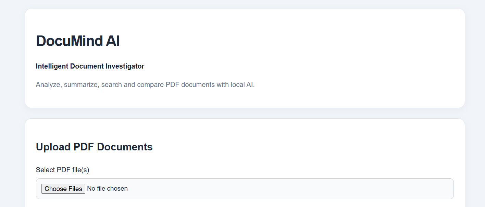
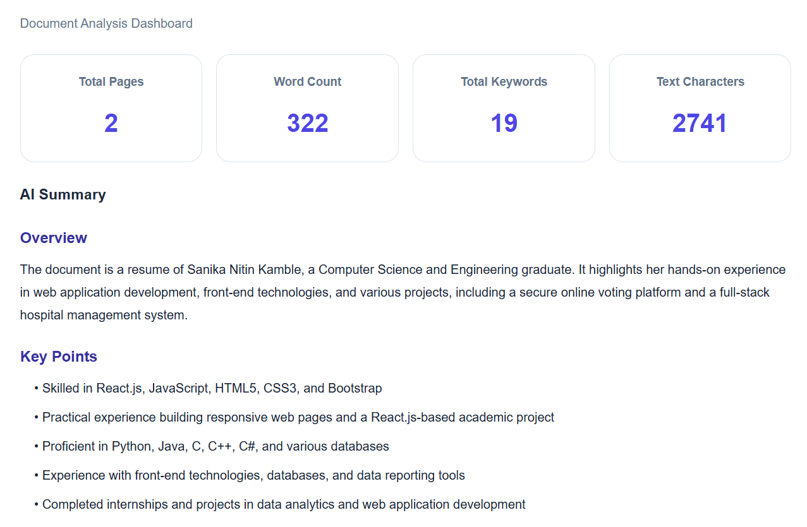
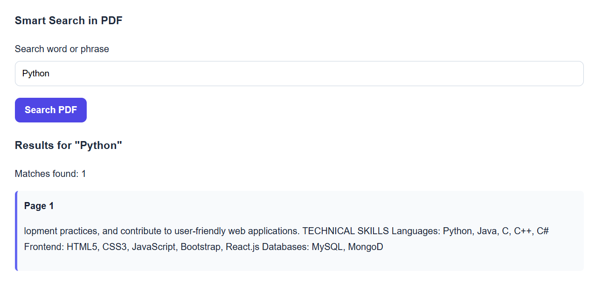
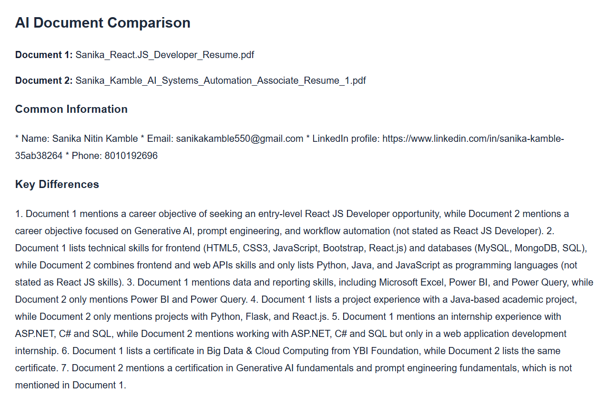
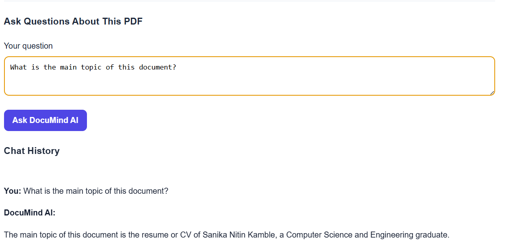

# DocuMind AI – Intelligent Document Investigator

An AI-powered document analysis application that helps users understand, search, summarize, and compare PDF documents using Generative AI.

## Project Overview

DocuMind AI is a Python-based web application developed using Flask and Ollama. It allows users to upload PDF documents and interact with their content through AI-powered features.

The application simplifies document investigation by generating summaries, answering questions, extracting keywords, searching document content, and comparing two PDF files.

## Key Features

- **AI-Powered PDF Summarization:** Generate meaningful summaries of uploaded PDF documents.
- **Ask Questions:** Ask questions about document content and receive AI-generated answers.
- **Smart Search:** Search for specific information and view relevant page context.
- **PDF Comparison:** Compare two PDF documents and identify common information and differences.
- **Keyword Extraction:** Extract important keywords from documents.
- **Document Dashboard:** View document statistics such as page count, word count, and text characters.
- **Page-wise Text Extraction:** View extracted text from individual PDF pages.
- **Download Reports:** Download generated summaries and PDF comparison reports.

## Technologies Used

| Category | Technologies |
|---|---|
| Programming Language | Python |
| Backend | Flask |
| Frontend | HTML, CSS, JavaScript |
| Generative AI | Ollama |
| AI Model | Llama 3.2 (3B) |
| PDF Processing | PyMuPDF |
| API Communication | Requests |

## Project Structure

```text
DocuMind_AI/
│
├── Backend/
│   ├── app.py
│   └── pdf_processor.py
│
├── static/
│   └── style.css
│
├── templates/
│   └── index.html
│
├── uploads/
├── document_data/
├── reports/
│
├── requirements.txt
├── README.md
└── .gitignore
```

## Installation and Setup

### 1. Clone the Repository

```bash
git clone https://github.com/Sanika213/DocuMind-AI.git
```

### 2. Open the Project Folder

```bash
cd DocuMind-AI
```

### 3. Create a Virtual Environment

```bash
python -m venv venv
```

### 4. Activate Virtual Environment (Windows)

```powershell
.\venv\Scripts\Activate.ps1
```

### 5. Install Dependencies

```bash
pip install -r requirements.txt
```

### 6. Install and Start Ollama

Install Ollama and download the model:

```bash
ollama pull llama3.2:3b
```

Start the model:

```bash
ollama run llama3.2:3b
```

Keep Ollama running while using the application.

### 7. Run the Flask Application

Open another terminal:

```bash
python Backend/app.py
```

### 8. Open in Browser

```text
http://127.0.0.1:5000
```

## Application Workflow

1. Open the DocuMind AI web application.
2. Upload a PDF document.
3. Generate an AI-powered summary.
4. Explore keywords and document statistics.
5. Search for information or ask questions.
6. Upload two PDFs to compare their content.
7. Download the generated reports.
## Screenshots

### 1. Dashboard


### 2. AI Summary


### 3. Smart Search


### 4. PDF Comparison


### 5. Ask AI


## Future Enhancements

- OCR support for scanned PDF documents.
- Support for additional document formats.
- Advanced document analytics.
- Improved AI response accuracy.
- Multi-document question answering.

## Author

**Sanika Kamble**

GitHub: [Sanika213](https://github.com/Sanika213)

---

⭐ If you find this project interesting, consider giving the repository a star!